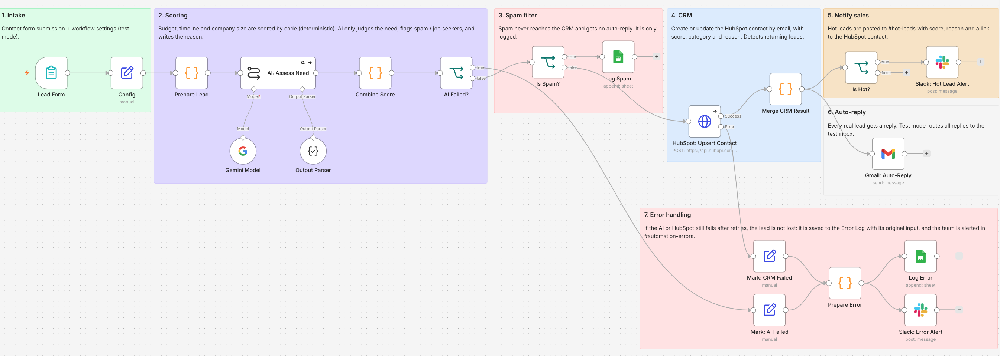
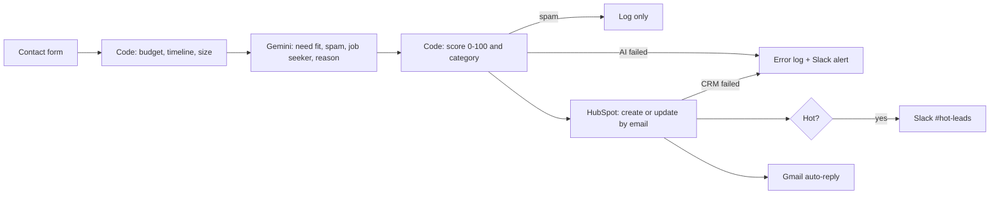

# AI Lead Qualifier for Contact Forms (n8n)

Scores every contact form submission, saves it to HubSpot, alerts sales in Slack when the lead is hot, and sends the lead an automatic reply. If the AI or the CRM fails, the lead is saved with its original input and the team is alerted, so no lead is lost.

> **Demo project.** Built for a fictional software agency, *Northwind Digital*, and tested with fictional leads. No real customer data was used.

**Demo video (2 min):** [watch it on LinkedIn](https://www.linkedin.com/feed/update/urn:li:activity:7518498370936537088/)



## The problem

Contact form submissions pile up. Someone in sales opens each one by hand. Spam, job seekers and "just curious" visitors take the same time as a buyer with a budget and a deadline, so the serious buyers wait.

## What the workflow does

| Stage | What happens |
|---|---|
| 1. Intake | An n8n form collects name, work email, company, company size, budget, start date and the request |
| 2. Scoring | Code scores budget, timeline and company size with fixed rules. Gemini judges only what needs judgment: does the request fit the agency's services, is it spam, is it a job seeker. It also writes a short reason for sales. Code combines both into a 0–100 score and a category |
| 3. Spam filter | Spam is logged, never added to the CRM and never answered |
| 4. CRM | The contact is created or updated in HubSpot by email, with score, category and reason. A repeat submission updates the same contact and is flagged as a returning lead |
| 5. Notify sales | Hot leads go to Slack `#hot-leads` with the score, the details, the AI's reason and a link to the HubSpot contact |
| 6. Auto-reply | Every saved lead gets an email. Hot leads, other leads and job seekers each get a different message |
| 7. Error handling | If the AI or HubSpot fails, the lead goes to a Google Sheets error log with its original input, and Slack `#automation-errors` gets an alert |



### Why the AI doesn't do the math

Budget, timeline and company size come from dropdowns, so code scores them. The result is the same every time, costs nothing, and is easy to explain when someone asks why a lead got 85. The AI handles the one part that needs judgment: reading the free-text request.

| Factor | Max points | Scored by |
|---|---|---|
| Budget | 35 | Code |
| Timeline | 25 | Code |
| Need fit (0, 12 or 25) | 25 | Gemini |
| Company size | 15 | Code |

**Hot** 70+ · **Warm** 40–69 · **Cold** under 40. Job seekers are capped at 10. Spam gets 0 and is filtered out.

## Test results

Measured on n8n 2.35.7 with free plans, October 2026, using the 12 fictional submissions in [`sample-data/test-leads.json`](sample-data/test-leads.json).

| Test | Result |
|---|---|
| Scoring | 12 of 12 leads landed in the expected category, in 3 test runs |
| 12 submissions | 10 HubSpot contacts: 1 spam filtered, 1 duplicate merged into the existing contact |
| Notifications | 5 Slack alerts (4 new hot leads + 1 returning hot lead), 11 auto-replies (spam gets none) |
| One lead, end to end | About 10 seconds from form submit to HubSpot, Slack and email (recorded demo) |
| AI speed | Under 1 second to 11 seconds per lead, depending on time of day (Gemini free tier) |
| CRM rejects one lead | That lead was saved to the error log with HubSpot's reason. The other 10 were still processed |
| AI fully down | Each lead got 3 attempts, then all 12 were saved to the error log. The run finished without crashing |
| AI usage | About 800 Gemini tokens per lead |
| Cost | $0 on free tiers |

## Tech stack

- **n8n** 2.35.7, self-hosted
- **Google Gemini** `gemini-3.5-flash-lite` (Basic LLM Chain + Structured Output Parser)
- **HubSpot CRM** free plan, through the batch upsert API with a Service Key
- **Slack** bot with only the `chat:write` scope
- **Gmail** for auto-replies
- **Google Sheets** as the error log

## How I built this

I built this with Claude (Anthropic) as my pair programmer. Claude drafted the first version of the workflow, the Code node logic, the AI prompt and this README. I made the design calls: what code scores and what the AI judges, what happens when a step fails, and how test mode keeps test emails away from real leads. I set up HubSpot, Slack and Google Cloud from scratch, configured and debugged the workflow in n8n, and tested it with 12 fictional leads. Then I ran two failure tests, one where HubSpot rejects a lead and one where the AI is down, to confirm that no lead is lost.

## How to run it

### 1. Accounts and keys

- **HubSpot.** Create three contact properties:
  - `lead_score`: Number, 0–100
  - `lead_category`: Dropdown with internal values `hot`, `warm`, `cold`
  - `lead_reason`: Multi-line text

  Create a Service Key (Settings → Integrations → Service Keys) with the scopes `crm.objects.contacts.read`, `crm.objects.contacts.write` and `crm.schemas.contacts.read`. If you test with `example.com` addresses, turn off *Create and associate companies with contacts* (Settings → Objects → Companies), or HubSpot creates a blank company for every test domain.
- **Slack.** Create an app with the bot scope `chat:write`, install it, and invite it to two channels: one for hot leads and one for errors. Copy both channel IDs (the bot can't list channels with this scope, which is intentional).
- **Google.** In Google Cloud, enable the Gmail API and Google Sheets API (plus the Google Drive API if you want to pick the sheet from a list in n8n) and create an OAuth client for n8n. Create a sheet with a tab named `errors` and the headers from [`sample-data/error-log-template.csv`](sample-data/error-log-template.csv).
- **Gemini.** Get an API key from Google AI Studio.

### 2. Import and connect

1. In n8n: **Workflows → Import from File** → [`workflow/lead-qualifier.json`](workflow/lead-qualifier.json).
2. Create the credentials (Google Gemini, HubSpot App Token, Slack API, Gmail OAuth2, Google Sheets OAuth2) and select them in each node that shows a credential warning.
3. In **Slack: Hot Lead Alert** and **Slack: Error Alert**, replace the channel ID placeholders with your channel IDs.
4. In **Log Spam** and **Log Error**, select your error log sheet.
5. In **Config**, set `test_inbox` to an inbox you own and keep `test_mode` on `true`.

### 3. Test without emailing anyone

- Open **Lead Form**, paste the contents of `sample-data/test-leads.json` as pinned output data, and click **Execute workflow**. You should get the numbers in the test results table.
- `test_mode` sends every auto-reply to `test_inbox`, with `[TEST → lead email]` in the subject. The test leads also use `example.com` domains, which can't receive email.
- To test the CRM error path, set `simulate_crm_error_for` in **Config** to one test lead's email. HubSpot rejects that lead and it lands in the error log.
- To test the AI error path, change the Gemini model name to one that doesn't exist and run again.

### 4. Go live

Set `test_mode` to `false`, activate the workflow, and use the form's production URL. Visitors can only reach it if your n8n instance is publicly accessible (a VPS, n8n Cloud, or a tunnel). To keep your existing website form, replace the Form Trigger with a Webhook that receives the same seven fields.

## Known limits and next steps

- If the AI is down for a whole batch, Slack gets one alert per failed lead. Next version: one summary alert per run.
- Gemini's free tier has per-minute and per-day limits. HubSpot calls are sent one lead at a time, 300 ms apart.
- While a Google OAuth app is in *Testing* status, the login expires every 7 days. Reconnect the Gmail and Sheets credentials, or publish the OAuth app.

## Files

```
workflow/lead-qualifier.json        n8n workflow (no credentials included)
sample-data/test-leads.json         12 fictional test submissions
sample-data/error-log-template.csv  Headers for the Google Sheets error log
images/workflow-canvas.png          Screenshot of the workflow
```

## About

Built by **Ridho Subkhan**, AI automation with n8n. [LinkedIn](https://www.linkedin.com/in/ridho-subkhan/) · [GitHub](https://github.com/ridho2420)
